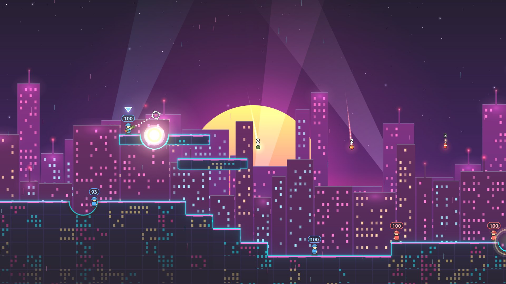

# Barrage

A Worms-lite artillery game for the browser. Two teams of three soldiers take turns lobbing
bazooka rockets, grenades, cluster bombs, airstrikes, shotgun blasts and dynamite across terrain
that breaks wherever a shot lands. Play a 15-level campaign against the computer, or duel a
friend on one keyboard.

[](https://barrage.cocode.dk)

## Play

**[barrage.cocode.dk](https://barrage.cocode.dk)**: free, nothing to install. A keyboard is best;
the mouse can aim and fire too.

## Features

- **15 battlefields, each with its own look**: Green Meadow, Desert Sunset, Autumn Forest, Arctic,
  Jungle, Neon City, Candy Land, Haunted Graveyard, Storm Coast, Underwater Reef, Volcano, Pixel
  Retro, Glacier Canyon, Moon and the Ember Sky Finale. Each has its own sky, terrain texture,
  weather and hazards.
- **Destructible terrain**: every blast carves a crater, so the map changes shape as the round goes on.
- **Campaign against the computer**: win a level to unlock the next. The computer aims by
  simulating its own shots, wind included.
- **Two-player hot-seat**: pick any level and hand the keyboard over each turn.
- **Watch, then try**: the "How to play" demo shows each move on a real battlefield, then gives
  you the controls to try it yourself.
- **Six weapons**, wind that bends rockets, water or lava that takes anyone who falls in, and a turn clock.

## Controls

| Key | Action |
|---|---|
| ← → or A D | Walk (climbs gentle slopes) |
| ↑ ↓ or W S | Aim, or point with the mouse |
| Enter | Jump |
| Hold Space | Charge power, release to fire (or hold the mouse button) |
| Q E or 1–6 | Change weapon |
| Esc | Pause |
| M | Sound on/off |

| Weapon | What it does |
|---|---|
| Bazooka | Rocket that bends with the wind and bursts on contact |
| Grenade | Bounces, then explodes after 3 seconds; ignores wind |
| Cluster bomb | A grenade that scatters five bomblets |
| Airstrike | Five missiles from the sky: move the marker, press Space to call it in |
| Shotgun | Instant shot, two per turn |
| Dynamite | Drop it and run: 4-second fuse, huge blast |

## Run locally

Plain HTML, CSS and JavaScript modules: no dependencies, no build step, no network requests at
runtime. Every URL is relative, so the folder also works under a sub-path (for example
`http://raspberrypi.local/barrage/`).

```sh
git clone https://github.com/cocodedk/barrage.git
cd barrage
python3 -m http.server 8000   # then open http://localhost:8000/
```

Any static file server works. Opening `index.html` straight from disk does not, because browsers
block ES modules on `file://`.

Add `?debug` to the URL for a frame-time readout. `dev.html` is a render bench for the levels
(`dev.html?level=6&boom=1`, `dev.html?level=all`); the options are listed at the top of the file.

## Tests

```sh
node --test
```

Node 20 or newer, nothing to install. The suites cover the rules and simulation (terrain,
physics, weapons, turns, AI) and the effects state. Pixels are not tested; the state that draws
them is. A repo test keeps every code file under 200 lines and keeps the game free of external URLs.

## Project layout

```
index.html        the game: one full-window canvas that loads src/main.js
src/main.js       boot, game loop (fixed 1/60 s logic step, rAF render), screen routing
src/core/         rules and simulation: rng, terrain mask and generator, levels, physics,
                  soldiers, weapons, turns, AI. Pure: no DOM, randomness and time passed in
src/fx/           effect state: particles, shockwaves, flashes, shake, floating text, camera. Pure
src/ui/           canvas drawing, screens, the how-to-play demo, input, audio, storage
test/             node:test suites mirroring src/core and src/fx
dev.html          render bench (not part of the game)
og.html           layout that renders og.png, the social preview image
```

| Part | Choice |
|---|---|
| Language | JavaScript ES modules, HTML, CSS |
| Rendering | Canvas 2D, 1920 × 1080 world, letterboxed to any screen |
| Audio | Web Audio, sounds synthesised at runtime |
| Tests | `node:test`, no dependencies |
| Hosting | GitHub Pages from the repository root |
| Target | 60 fps on a Raspberry Pi 4 |

## Contributing

See [CONTRIBUTING.md](CONTRIBUTING.md). Security reports go through [SECURITY.md](SECURITY.md).

## Author

**Babak Bandpey** — [https://cocode.dk](https://cocode.dk) | [LinkedIn](https://linkedin.com/in/babakbandpey) | [GitHub](https://github.com/cocodedk)

## License

Apache-2.0 | © 2026 [Cocode](https://cocode.dk) | Created by [Babak Bandpey](https://linkedin.com/in/babakbandpey)
